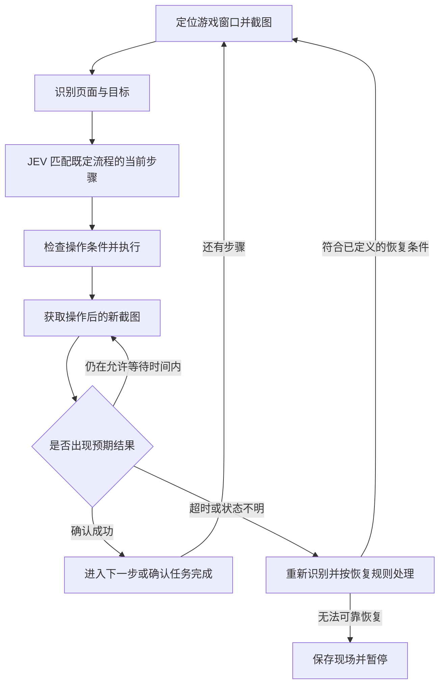

# JEV 日常自动化方案（评审草案）

本方案以项目 README 中的定义为依据：JEV 根据识别结果，按照预先确定的日常活动流程执行对应操作，完成《堕落玩偶》的日常任务自动化。方案制定时项目只有说明文档；以下内容保留为设计基线，当前实现进度和运行方式见 [README](../README.md)。

## 目标与首版范围

首版目标是可靠完成一条真实的日常活动流程，并能明确报告“完成”“已完成并跳过”或“暂停及原因”。完成判断必须来自游戏界面中的可观察证据。

暂按 Windows 本地运行、游戏处于前台、用户已登录的使用方式设计。首版支持一套经过验证的游戏语言、窗口尺寸和显示缩放配置，允许窗口移动。具体日常步骤以现有活动流程和实际界面为准。

首版包括窗口截图、界面识别、流程配置、JEV 决策执行、暂停与恢复、结果记录。后续再扩展其他日常流程、布局配置及操作面板。

## 工作方式



JEV 核心采用流程状态机：识别结果提供当前事实，流程配置决定下一步动作。步骤可包含明确的条件分支，例如存在可执行任务时进入处理流程，识别到已完成状态时跳过。

## 模块与推荐选型

| 模块 | 职责 | 首版建议 |
| --- | --- | --- |
| 窗口与截图 | 绑定目标窗口，采集客户区画面，记录截图时间与窗口位置 | Python + Windows 窗口 API；先验证 mss 截图是否适用于游戏 |
| 内容识别 | 输出页面标识、目标位置、文字、匹配分数及截图信息 | OpenCV 模板匹配与区域检查；文字确有必要时接入 RapidOCR |
| 流程配置 | 描述步骤、条件、动作与完成证据 | YAML 配置，启动时校验必填项与步骤引用 |
| JEV 决策 | 匹配当前步骤，执行分支、等待、跳过与恢复规则 | Python 状态机，只依据明确配置作出动作选择 |
| 操作执行 | 执行点击、按键等步骤动作 | 先验证 PyAutoGUI 标准输入是否被游戏接受 |
| 运行记录 | 提供状态、暂停原因、关键截图与运行结果 | 首版命令行状态输出、全局暂停热键与本地日志 |

识别优先关注当前步骤需要的局部区域。固定图标和页面锚点使用模板识别；需要读取文字或数字时才调用 OCR。匹配阈值必须用真实截图样本校准，模板分数不能直接当作正确率。

截图或输入兼容性需要首先在目标游戏中验证。若上述方案无法正常采集或操作，再依据验证结果调整截图后端或标准输入实现。

## 每个流程步骤需要定义什么

| 信息 | 用途 |
| --- | --- |
| 步骤标识与进入条件 | 确认当前画面允许执行此步骤 |
| 识别目标 | 指定页面锚点、按钮、文字及检查区域 |
| 执行动作 | 指定要点击的识别目标或要发送的按键 |
| 成功条件 | 指定操作后应出现的界面证据 |
| 下一步与分支 | 决定成功、已完成等状态的后续路径 |
| 超时与重试上限 | 限制等待和恢复次数 |
| 是否可安全重复 | 决定结果不明时能否重新执行 |
| 失败去向 | 指定已验证的恢复步骤，或保存现场并暂停 |

以“进入某项日常 → 执行对应操作 → 确认完成”为示意流程：点击入口后，必须识别到对应页面，才能执行该页操作；最后识别到该日常的明确完成标记，才能计入完成结果。这个示例不代表已确认游戏中的实际按钮或活动规则。

## 运行规则

- 每次输入前检查目标窗口身份、前台状态、客户区尺寸和必要定位标记。点击位置由识别目标及窗口客户区坐标确定；窗口移动后重新换算位置。
- 操作发出后进入等待确认状态，使用操作之后采集的新截图判断结果，避免界面响应延迟时连续点击。
- 输入未生效、等待结束或目标暂时消失，均不能单独证明任务已经完成。流程需要配置明确的成功证据。
- 超时后先重新识别。仅在仍满足进入条件、允许安全重复且未超过重试上限时再次执行；结果不明则暂停。
- 未知页面、多个状态同时匹配且无法区分、窗口最小化或布局超出支持范围时，保存截图和原因并暂停。
- 暂停后停止发送后续输入并释放工具持有的按键；恢复前重新识别游戏状态，核对已有完成证据，不直接重放上次步骤。
- 日志区分“动作已发出”“结果已确认”“结果待确认”，运行报告分别列出已完成、已完成并跳过、失败暂停及未执行的任务。

## 建议实施顺序与验收

| 阶段 | 交付内容 | 验证方法 |
| --- | --- | --- |
| 1. 确认一条真实流程 | 步骤清单、关键页面截图、完成条件、目标窗口配置 | 逐步核对每个步骤都有进入条件和可观察的成功证据 |
| 2. 验证截图与输入 | 能截图、定位目标并执行一个可验证的页面操作 | 实测截图有效、点击被接受；窗口移动后定位正确；失去前台时停止输入 |
| 3. 实现识别与流程校验 | 页面/目标识别器与单条流程配置 | 用正常、相似、遮挡、加载画面样本验证；不能区分的画面不触发动作；不完整配置不能启动 |
| 4. 跑通 JEV 闭环 | 按条件执行、等待确认、分支跳过、超时暂停 | 实际完成一次日常；输入未生效或画面不变时不能推进；已完成状态再次启动时正确跳过 |
| 5. 验证恢复并交付首版 | 暂停热键、有限重试、运行日志与使用说明 | 在动作前、动作后待确认、确认后三个位置中断；恢复后不跳步、不重复结果不明的动作；未知画面暂停并留有证据 |

不依靠重复执行同一项日常验证所有分支：识别与状态转换主要使用已采集截图回放，操作兼容性和真实完成情况在游戏中验证。记录识别与决策耗时，待真实画面和运行环境确定后再设定性能目标。

## 拟新增文件

以下为方案评审时建议的组织方式，实际实现另将状态机独立为 `engine.py`，并增加命令行、演示和回放入口。

```text
src/jev/
  capture.py       窗口绑定与截图
  recognize.py     模板、区域与文字识别
  workflow.py      流程加载、校验与状态转换
  actions.py       窗口检查及鼠标键盘操作
  runner.py        运行循环、暂停与结果记录
config/
  window.yaml      首版窗口与显示配置
flows/
  daily.yaml       第一条确认后的日常流程
assets/templates/  页面与操作目标的模板
tests/fixtures/    识别与状态转换验证所用的界面样本
```

## 开发前需要补充的材料

最先需要一条既定日常流程：从哪个页面开始、依次进行哪些操作、哪些情况需要分支或跳过、看到什么才算完成，并附对应页面截图或录屏。

随后记录游戏语言、窗口模式、分辨率与系统显示缩放，验证截图和标准输入是否兼容。界面更新可能要求重新采集模板；兼容性和识别效果通过上述早期验证决定后续实现细节。

建议首个里程碑定为：在约定的运行配置下，用户启动工具后可完整完成一条真实日常；遇到无法判定的情况明确暂停，并提供可用于排查的截图与原因。
